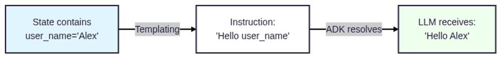

# Memory and State Management

- [Keys](https://aistudio.google.com/api-keys)
- [Usage Info](https://aistudio.google.com/u/1/usage?timeRange=last-28-days&project=gen-lang-client-0434909001&pli=1)

Problem statement: Imagine interacting with an assistant that forgets your preferences the moment you switch topics,  
or fails to carry crucial user data across steps because it relies purely on conversational guesswork.  
Stateless responders can answer one-off questions, but they can't manage meaningful, multi-step workflows.

True intelligent assistants don't just react. They remember, adapt, and maintain state.  

## Why this matters

Production-grade applications require deterministic data handling and personalized user journeys,  
not just fleeting text generation. Mastering session state and memory transforms your agents from transient chatbots into dependable,  
context-aware systems ready for complex real-world workflows.

## Managing State and memory

The problem: Conversation history alone isn’t enough for programmatic control

What if your code needs to check specific values or make programmatic decisions based on conversation data?  
For example:  
- How do you check “Has the user provided their name?” in your code?  
- How do you store an extracted value for later use in your application?
- How do you make routing decisions based on exact data (not LLM interpretation)?  

### Conversation history alone isn’t enough for programmatic control

#### The limitation

Conversation history is sent to the LLM, but your code cannot programmatically access it.  
You can't write if conversation_history.contains("Alex"): because conversation history isn't a data structure your code can query.  
It's just text messages sent to the model.
- This part introduces session state, a dictionary your code can read and write programmatically.

#### Solution: Use session state for structured data

[Reference](https://adk.dev/sessions/state/)

The root problem
While the LLM can read conversation history and respond appropriately, your code cannot programmatically check values or make routing decisions. You need structured, programmatically accessible data.

Let’s see what happens when you try to build agents that need to make decisions based on conversation data:
```
from google.adk.agents import LlmAgent

# Agent that should extract and remember user's name
agent = LlmAgent(
    name="name_extractor_agent",
    model="gemini-flash-latest",
    instruction="Extract the user's name and remember it for future questions."
)

# Turn 1
# User: "My name is Alex"
# Agent: "Nice to meet you, Alex!"

# Turn 2
# User: "What's my name?"
# Agent: "Your name is Alex" (LLM remembers from history)

# But in your code:
# How do you check if name was provided?
# How do you access the exact name "Alex"?
# How do you use it in application logic?
```

[Reference](https://adk.dev/sessions/state/)

##### Core Concepts
**1. State versus conversation history**

| Feature | Conversation History | Session State |
|---------|--------------------|---------------|
|What it is|Text messages (user + agent)|Dictionary of key-value pairs|
|LLM can read|Yes (automatic)|Yes (via {key} templating, Part 2)|
|Code can check|Yes (via session.events), but unwieldy for structured logic|Yes (session.state.get("key"))|
|Use for|Context for LLM|Exact values for your code|
|Access|Automatic (sent to model)|Programmatic (session.state) and templated ({key})|

When to use state:
- When your code needs to check exact values (if state.get("name"):).
- When making routing decisions programmatically.
- When tracking conversation progress or user information.
- DON’T use for only providing context to LLM (conversation history already does that).

**2. Accessing state with session.state**

[ADK documentation - How State is Updated: Recommended Methods](https://adk.dev/sessions/state/#how-state-is-updated-recommended-methods)   

After running your agent, you access state through the session.state dictionary:

Examples
```
Example 1:
Following line in agent_instructions.txt
You are Alex {agentName?}, a Senior Technical Support Specialist with 5 years of experience.

Example 2: 
Following line in SateManagementExample.java
System.err.println(session.state().get("request_output"));
```

**3. Saving responses with output_key**

[Reference](https://adk.dev/agents/llm-agents/#data-handling)
[Output Key Documentation](https://adk.dev/agents/llm-agents/#output-key)

**How It Works**:  
- Agent generates response (e.g., “quantum computing”).
- Framework automatically saves to state["topic"] = "quantum computing".
- You can access it with session.state.get("topic").

**When to use**:
- You want to save the agent’s response for later use.
- You need programmatic access to what the agent said.
- When building applications that need to track extracted information.
- DON’T use for: Responses you don’t need to reference later.

Examples
```
Example:
Simple option:  
.outputKey("request_output") // Store result in state.get("found_capital")
```

### The problem: How do agents use state values in their instructions?
The next step  
Learn how to use those saved values inside agent instructions, making your agents dynamic and context-aware.  

- **The challenge**: You want instructions to adapt based on state values. You want the agent to automatically use “Alex” and “Spanish” without hard-coding them.
- **What you need**: A way to inject state["user_name"] and state["user_language"] into the instruction automatically

#### The solution: State templating with {key}
[ADK Documentation - Accessing Session State in Agent Instructions](https://adk.dev/sessions/state/#accessing-session-state-in-agent-instructions)

"When working with LlmAgent instances, you can directly inject session state values into the agent's instruction string using a simple templating syntax.  
This allows you to create dynamic and context-aware instructions without relying solely on natural language directives."

```
Example
from google.adk.runners import Runner
from google.adk.sessions import InMemorySessionService

# Setup
session_service = InMemorySessionService()
session = session_service.create_session(app_name="app", user_id="user1")

# Manually set state (simulating previous interaction or external data)
session.state["user_name"] = "Alex"
session.state["user_language"] = "Spanish"

# Agent with templating
agent = LlmAgent(
    name="localized_greeter",
    model="gemini-flash-latest",
    instruction="Hello {user_name}. Please respond in {user_language}."
)

# When agent runs:
# LLM receives: "Hello Alex. Please respond in Spanish."
```

##### Core concepts

1. [State templating syntax: {key}](https://adk.dev/sessions/state/#using-key-templating)
2. [Optional templating: {key?}](https://adk.dev/sessions/state/#important-considerations)  


